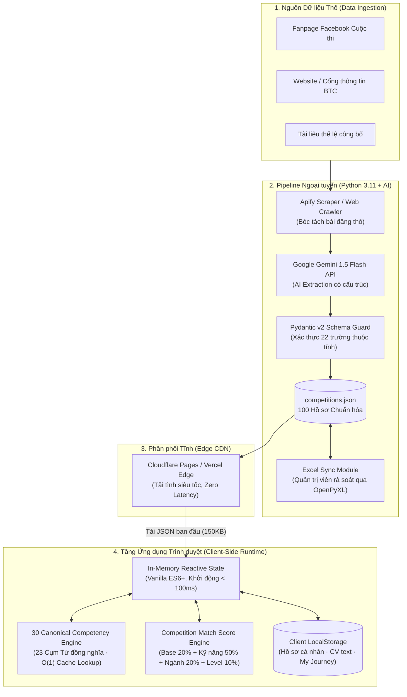

# 🏆 CompeteMate — Discover · Match · Compete
> **Nền tảng khám phá, đánh giá mức độ phù hợp và hỗ trợ chuẩn bị cuộc thi học thuật cho sinh viên Việt Nam**

[](LICENSE)
[](https://developer.mozilla.org/en-US/docs/Web/JavaScript)
[](https://www.python.org/)
[](https://docs.pydantic.dev/)
[](https://ai.google.dev/)
[](file:///D:/HA/DESIGN_SYSTEM.md)

---

## 📖 1. Tổng quan Dự án (Product Overview)

### 1.1. Bối cảnh & Vấn đề thực tế
Hàng năm có hàng trăm cuộc thi học thuật và khởi nghiệp lớn nhỏ dành cho sinh viên (*Business Case, Marketing, Khởi nghiệp, Tài chính - Kế toán, Công nghệ - AI, Hùng biện - MC, Quản trị - Chuỗi cung ứng*). Tuy nhiên, các kênh truyền thông hiện tại (Fanpage Facebook, website tổng hợp cơ hội) chỉ dừng lại ở việc đăng tải thông tin một chiều:
> *"Cuộc thi nào đang mở đơn?"*

Sinh viên thực tế đối mặt với 4 rào cản cốt lõi:
1. **Thiếu định hướng phù hợp (*What suits me?*):** Chưa rõ cuộc thi nào tương thích với năng lực, chuyên ngành và cấp độ kinh nghiệm hiện tại.
2. **Không đo lường được khoảng cách năng lực (*What am I missing?*):** Chưa biết tiêu chí chấm của Ban giám khảo đòi hỏi kỹ năng gì, mình đã có gì và còn thiếu kỹ năng then chốt nào (*Skill Gap Matrix*).
3. **Kinh nghiệm thực chiến bị phân tán (*How should I prepare?*):** Lời khuyên, bẫy thường gặp và cẩm nang giải đề từ cựu Quán quân chưa được hệ thống hóa bài bản.
4. **Áp lực theo dõi tiến độ (*How to track?*):** Khó quản lý nhiều deadline song song giữa các vòng thi (*Vòng đơn, Bán kết, Chung kết*), dẫn đến tình trạng trễ hạn nộp bài.

### 1.2. Giải pháp Toàn diện từ CompeteMate
CompeteMate chuyển đổi quá trình tìm kiếm thụ động thành **Hành trình ra quyết định có căn cứ (Engineered Decision Journey)** khép kín qua 5 giai đoạn:

```
┌──────────────┐     ┌──────────────┐     ┌──────────────┐     ┌──────────────┐     ┌──────────────┐
│ 1. DISCOVER  │ ──> │ 2. EVALUATE  │ ──> │  3. PREPARE  │ ──> │   4. TRACK   │ ──> │   5. LEARN   │
│ (CompeteHub) │     │(CompeteMatch)│     │(Skill DNA)   │     │ (My Journey) │     │  (Playbook)  │
└──────────────┘     └──────────────┘     └──────────────┘     └──────────────┘     └──────────────┘
```

---

## 🏛️ 2. Kiến trúc Hệ thống (System Architecture)

Hệ thống được thiết kế theo mô hình **2 tầng phân tách hoàn toàn (Two-Tier Decoupled Architecture)**:
1. **Tầng Pipeline Dữ liệu Ngoại tuyến (Offline Data & AI Pipeline):** Tự động thu thập bài đăng, sử dụng Google Gemini 1.5 Flash bóc tách dữ liệu có cấu trúc, kiểm duyệt lược đồ qua Pydantic v2 và đồng bộ file Excel/JSON.
2. **Tầng Ứng dụng Phía Trình duyệt (Client-Side Privacy-First Web Runtime):** Hoạt động trực tiếp trên trình duyệt bằng Vanilla ES6+ và CSS thuần. Ứng dụng triết lý **Zero-Server Lag & 100% Data Privacy** (toàn bộ hồ sơ cá nhân và CV của sinh viên được lưu trữ trên `localStorage`, không gửi dữ liệu nhạy cảm ra ngoài).



---

## ✨ 3. Tính năng Cốt lõi (Core Features)

### 3.1. CompeteHub — Khám phá & Bộ lọc Đa chiều Thông minh
- **Tìm kiếm tức thì (Real-time Instant Search):** Tìm kiếm theo tên cuộc thi, đơn vị tổ chức, chủ đề và từ khóa kỹ năng mà không có độ trễ.
- **Lọc theo 7 Nhóm chuyên môn chính:**
  - *Tất cả năng lực*
  - *Chiến lược & Tư duy (5 năng lực)*
  - *Kinh doanh & Khởi nghiệp (5 năng lực)*
  - *Tài chính, Kế toán & Dữ liệu (4 năng lực)*
  - *Công nghệ & AI (3 năng lực)*
  - *Truyền thông & Thuyết trình (5 năng lực)*
  - *Quản trị & Thực thi (8 năng lực)*
- **Lọc tổ hợp linh hoạt:** Trạng thái đơn (*Đang mở, Sắp đóng, Đã đóng*), Cấp độ kinh nghiệm (*Beginner, Intermediate, Advanced*), Quy mô đội thi, và Sắp xếp (*Theo Match Score, Hạn nộp gần nhất, Tên A-Z*).
- **So sánh trực diện (Compare Drawer):** Đặt tối đa 3 cuộc thi lên cùng một bảng đối sánh chi tiết về thời hạn, cơ cấu giải thưởng, yêu cầu kỹ năng và quy mô đội.

### 3.2. Competition DNA — Hồ sơ Cuộc thi Chuẩn hóa Chuyên sâu
Thay vì chỉ sao chép bài đăng mạng xã hội, mỗi cuộc thi được chuẩn hóa thành một hồ sơ kỹ thuật gồm 22 thuộc tính:
- **Lộ trình từng vòng (Milestones Timeline):** Ngày bắt đầu, hạn nộp bài và mô tả nhiệm vụ từng vòng (Vòng đơn, Bán kết, Chung kết).
- **Phân loại Kỹ năng 2 cấp độ:** Kỹ năng cốt lõi (`must_have`) và Kỹ năng bổ trợ (`nice_to_have`).
- **Bóc tách Cơ cấu Giải thưởng 5 khía cạnh (Prize Breakdown):** Phân loại minh bạch tiền mặt, học bổng & đào tạo, đặc quyền ươm tạo, hiện vật và điểm rèn luyện kèm nút xem văn bản gốc từ BTC.
- **Nút hành động trực tiếp:** Chuyển thẳng đến Google Form/Website mở đơn chính thức của BTC.

### 3.3. CompeteMatch — Thuật toán Đo lường Độ phù hợp (Match Score)
Thuật toán tính điểm tương thích **Match Score (15% – 98%)** phản ánh chân thực khả năng cạnh tranh của ứng viên:

$$\text{Score} = \text{Base (20)} + S_{\text{skill}} (0 - 50) + S_{\text{category}} (0 - 20) + S_{\text{level}} (-10 \text{ đến } +10)$$

* **Điểm Kỹ năng ($S_{\text{skill}}$ - Tối đa 50 điểm):** Kỹ năng `must_have` nhân hệ số 2.5, kỹ năng `nice_to_have` nhân hệ số 1.0.
* **Điểm Chuyên ngành ($S_{\text{category}}$ - 20 điểm):** Cộng 20 điểm nếu ngành học trùng khớp với lĩnh vực cuộc thi.
* **Điểm Kinh nghiệm ($S_{\text{level}}$):** Cộng 10 điểm nếu phù hợp cấp độ; phạt trừ 10 điểm nếu thí sinh mới bắt đầu (Beginner) thi đấu ở giải nâng cao (Advanced).
* **3 Chốt chặn an toàn (Sanity Caps):**
  - Không có kỹ năng nào khớp: Khóa điểm tối đa ở mức **35%**.
  - Cuộc thi chưa công bố kỹ năng: Khóa điểm tạm thời ở mức **45%**.
  - Xếp hạng xuất sắc (**Best Fit $\ge 80\%$**): Bắt buộc phải khớp ít nhất **2 kỹ năng thực tế**, nếu không chỉ đạt tối đa **75%**.

### 3.4. Ma trận Khoảng cách Năng lực & Mô phỏng Tăng điểm (Skill Gap Sandbox)
- **Strengths (Thế mạnh):** Các kỹ năng người dùng sở hữu trùng khớp với yêu cầu của cuộc thi (màu xanh lục).
- **Skills to Develop (Khoảng cách):** Kỹ năng cần bổ sung để tăng tính cạnh tranh (màu cam hổ phách).
- **Trình mô phỏng tăng điểm (% Uplift Simulation):** Cho phép người dùng thử tích chọn một kỹ năng mới học để hệ thống tính toán lại toàn bộ và hiển thị số % điểm tương thích tăng thêm.

### 3.5. 1-Click CV Onboarding
- **Trích xuất thông minh:** Người dùng tải file hoặc dán văn bản CV/LinkedIn.
- **Regex Pattern Parser:** Tự động nhận diện Họ tên, Trường đại học (FTU, NEU, UEH, RMIT, HVTC, DAV, HUST, VNU, FPT, BUV...) và 18 kỹ năng mục tiêu để khởi tạo hồ sơ tức thì.

### 3.6. Winner's Playbook — Bí kíp Thực chiến từ Quán quân
Hệ thống hóa kinh nghiệm cựu thí sinh theo bộ khung chuẩn mực 4 câu hỏi:
1. *Thử thách lớn nhất là gì?* (Choke points & bottlenecks).
2. *Sai lầm tân binh thường mắc phải?* (Common mistakes to avoid).
3. *Yếu tố then chốt để đoạt giải?* (Key success factors).
4. *Lời khuyên chuẩn bị ôn luyện từng tuần?* (Actionable prep advice).

### 3.7. My Competition Journey — Bảng điều khiển Quản lý Tiến độ
- **Theo dõi trạng thái:** Phân luồng cuộc thi theo *Theo dõi (Tracking)* $\rightarrow$ *Chuẩn bị (Preparing)* $\rightarrow$ *Đã nộp bài (Submitted)* $\rightarrow$ *Hoàn thành (Finished)*.
- **Checklist thông minh:** Tự động tạo danh mục việc cần làm tương ứng với từng mốc thời gian thi đấu.
- **Đồng bộ Lịch iCal:** Xuất file `competemate_schedule.ics` để đồng bộ trực tiếp vào Google Calendar hoặc Apple Calendar trên điện thoại.

---

## 🎨 4. Quy chuẩn Thiết kế UI/UX (Design Constitution)

CompeteMate tuân thủ triệt để nguyên tắc **"Pure Modern Light · Editorial · Clean Engineered"** được quy định tại [`AGENTS.md`](file:///D:/HA/AGENTS.md) và [`DESIGN_SYSTEM.md`](file:///D:/HA/DESIGN_SYSTEM.md):

* **100% Flat Design:** Tuyệt đối không dùng gradient, đổ bóng giả lập (zero decorative shadows) hoặc hiệu ứng phát sáng lòe loẹt.
* **Bảng màu Chuẩn:**
  - `Canvas Background`: `#FAFBFC` (Sáng sạch, thanh thoát)
  - `Surface Panels`: `#F4F5F7` (Vùng phụ trợ, thanh lọc)
  - `Cards & Modals`: `#FFFFFF`
  - `Text Primary`: `#18181B` (Zinc-900)
  - `Hairline Borders`: `1px solid #E4E4E7`
  - `Brand Accent`: `#FF7A00` (Sunset Orange phẳng đơn sắc)
* **Bộ đôi Typography:**
  - **Inter Tight:** Display Hero, Tiêu đề (H1, H2, H3) và các con số chỉ số (Metrics/Score).
  - **Inter:** Thân bài (Body text), dữ liệu chi tiết và bài viết kinh nghiệm.
* **Hệ thống Spacing 4px Rhythm:** `--space-1` (4px) đến `--space-8` (64px).
* **Biểu tượng:** 100% SVG Monochrome đồng nhất (`stroke-width="1.75"`), kích thước chuẩn 16-18px, không sử dụng emoji thô sơ trong giao diện kỹ thuật.

---

## 📊 5. Khung 30 Năng lực Chuẩn hóa (Competency Framework)

Hệ thống tích hợp **30 Năng lực Chuẩn hóa (Canonical Competencies)** bao trùm toàn bộ các cuộc thi, kết hợp **23 cụm từ đồng nghĩa song ngữ Anh - Việt** với cơ chế tra cứu $O(1)$ qua bộ nhớ đệm:

| Nhóm chuyên môn (Domain) | Số lượng | Danh sách Năng lực Chuẩn hóa |
| :--- | :---: | :--- |
| **Chiến lược & Tư duy** | 5 | Problem Solving, Critical Thinking, Strategic Thinking, Business Case Analysis, Design Thinking |
| **Kinh doanh & Khởi nghiệp** | 5 | Business Model Canvas (BMC), Business Planning & Proposal, Market Research, MVP Development, Pitching & Fundraising |
| **Tài chính & Dữ liệu** | 4 | Data Analysis & Analytics, Financial Analysis & Investment, Valuation & Accounting, Risk Management |
| **Công nghệ & AI** | 3 | Coding & Software Development, AI Tools & Prompt Engineering, UI/UX Design |
| **Truyền thông & Thuyết trình** | 5 | Presentation & Public Speaking, MC & Hosting, Slide Design & Storytelling, Debate & Q&A Defense, Marketing & Growth |
| **Quản trị & Thực thi** | 8 | Teamwork & Collaboration, Leadership, HR Management, Project Management, Time Management, Supply Chain & Operations, English Proficiency, ESG & Sustainability |

---

## 🛠️ 6. Hướng dẫn Cài đặt & Vận hành (Quickstart)

### 6.1. Khởi chạy Ứng dụng Web (Frontend Portal)
Hệ thống chạy trên nền web tĩnh siêu nhẹ không yêu cầu build phức tạp:

**Cách 1: Sử dụng kịch bản 1-click (Windows)**
```cmd
run_web.bat
```
*(Trình duyệt sẽ tự động mở tại `http://localhost:3333`)*

**Cách 2: Sử dụng Python HTTP Server**
```bash
python -m http.server 3333
```

---

### 6.2. Cấu hình & Vận hành Pipeline Dữ liệu (Python 3.11+)

**1. Cài đặt các thư viện cần thiết:**
```bash
pip install requests beautifulsoup4 pydantic fastapi uvicorn openpyxl google-generativeai
```

**2. Thiết lập biến môi trường:**
Tạo file `.env` tại thư mục gốc dự án:
```env
GEMINI_API_KEY=your_gemini_api_key_here
APIFY_API_TOKEN=your_apify_token_here
```

**3. Khởi chạy Pipeline tự động:**
```cmd
# Chạy pipeline theo dõi một cuộc thi cụ thể
run_pipeline.bat --url https://www.facebook.com/yec.calliope

# Hoặc chạy kiểm tra danh mục cuộc thi hiện có
run_pipeline.bat --list-competitions
```

**4. Khởi chạy Giao diện Quản trị Ingestion Studio:**
```cmd
run_studio.bat
```
*(Mở trình duyệt quản trị tại `http://127.0.0.1:8765`)*

---

## 📁 7. Cấu trúc Thư mục Dự án (Project Structure)

```text
d:/HA/
├── index.html                  # Giao diện chính ứng dụng CompeteMate (SPA)
├── styles.css                  # Hệ thống CSS chuẩn (100% Flat Tokens, Zero AI Slop)
├── app.js                      # Logic cốt lõi: Router, State, Match Engine, Competencies
├── logo.png                    # Brand logo CompeteMate
├── competehub.html             # Route điều hướng CompeteHub
├── competition_dna.html        # Route điều hướng Competition DNA
├── my_journey.html             # Route điều hướng My Journey
├── profile.html                # Route điều hướng Hồ sơ người dùng
│
├── run_web.bat                 # Kịch bản 1-click chạy Web Portal (Cổng 3333)
├── run_studio.bat              # Kịch bản 1-click chạy Ingestion Studio (Cổng 8765)
├── run_pipeline.bat            # Kịch bản 1-click chạy Data Pipeline
├── chay_phan_tich.bat          # Kịch bản 1-click phân tích AI và đồng bộ Excel
│
├── data/                       # Cơ sở dữ liệu và tệp lưu trữ
│   ├── competitions.json       # CSDL 100 cuộc thi chuẩn hóa chính thức
│   ├── competitions.js         # Dữ liệu JS nhúng dự phòng
│   ├── competitions.db         # SQLite database hỗ trợ chỉ mục
│   ├── raw_posts/              # Dữ liệu bài đăng mạng xã hội cào thô
│   └── backups/                # Bản sao lưu dữ liệu Excel
│
├── pipeline/                   # Hệ thống Pipeline tự động & AI Engine
│   ├── config.py               # Cấu hình API, tham số và danh sách AI Model
│   ├── models.py               # Lược đồ Pydantic v2 xác thực 22 trường thuộc tính
│   ├── scraper_apify.py        # Module cào Fanpage Facebook qua Apify
│   ├── scraper_web.py          # Module cào website cuộc thi chính thức
│   ├── ai_extractor.py         # Module trích xuất dữ liệu có cấu trúc qua Gemini API
│   ├── excel_sync.py           # Bộ đồng bộ dữ liệu 2 chiều Excel (OpenPyXL)
│   ├── db_syncer.py            # Module đồng bộ dữ liệu SQLite & JSON
│   ├── server.py               # FastAPI Server phục vụ Ingestion Studio
│   ├── run_pipeline.py         # Bộ điều phối Pipeline toàn diện qua CLI
│   └── web_ui/                 # Giao diện web Ingestion Studio
│
├── TAKENOTE CÁC CUỘC THI PROJECT TIN314.xlsx # CSDL Excel quản trị chính thức
├── AGENTS.md                   # Hiến pháp UI & Quy tắc kỹ thuật bắt buộc
├── DESIGN_SYSTEM.md            # Đặc tả Design Tokens, Màu sắc, Spacing, Typography
├── CONTENT.md                  # Bản quy chuẩn nội dung, microcopy và thuật ngữ
├── PRODUCT.md                  # Bản đặc tả sản phẩm & Core User Journey
├── check.md                    # Bộ 15 tiêu chí kiểm thử UI bắt buộc
├── hướng_dẫn.md                # Cẩm nang phát triển và hướng dẫn thực thi
├── báo cáo.md                  # Báo cáo kỹ thuật chi tiết Phần 3 & Phần 4
└── .gitignore                  # Cấu hình loại trừ file trong Git
```

---

## 💰 8. Chi phí Vận hành Ước tính (Operating Cost)

Nhờ kiến trúc Tĩnh phi máy chủ (Serverless Jamstack Architecture), hệ thống đạt mức tối ưu chi phí vận hành:
* **Hosting & CDN:** Cloudflare Pages / Vercel (Miễn phí vĩnh viễn) $\rightarrow$ **0 VNĐ / tháng**.
* **Cơ sở dữ liệu người dùng:** Client LocalStorage (Không tốn server DB) $\rightarrow$ **0 VNĐ / tháng**.
* **API AI Trích xuất (Batch Pipeline):** Google Gemini 1.5 Flash (~1 triệu tokens/tháng) $\rightarrow$ **~10.000 VNĐ / tháng**.
* **Tên miền quốc tế:** Duy trì hàng năm $\rightarrow$ **~25.000 VNĐ / tháng**.
* **TỔNG CHI PHÍ VẬN HÀNH:** **< 100.000 VNĐ / tháng**.

---

## 🤝 9. Bản quyền & Đóng góp (License & Contribution)

CompeteMate được phát triển nhằm mục tiêu hỗ trợ và nâng cao năng lực cạnh tranh cho cộng đồng sinh viên Việt Nam trong các sân chơi học thuật.

* **Bản quyền:** [MIT License](LICENSE) — Tự do phát triển và mở rộng phi thương mại.
* **Đội ngũ phát triển:** CompeteMate Engineering Team (2026).
